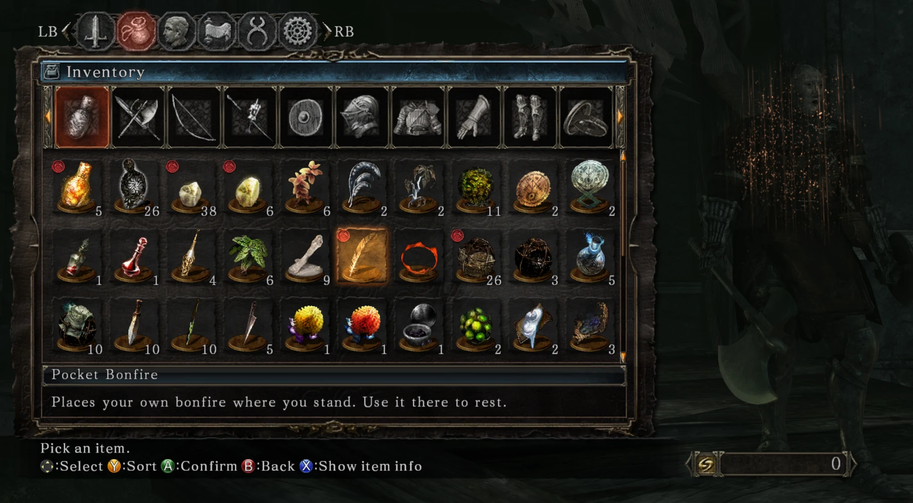
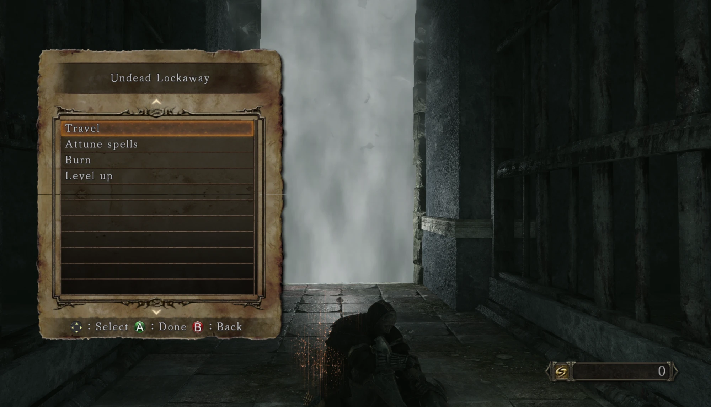

# Pocket Bonfire

A mod for Dark Souls II: Scholar of the First Sin that cuts down boss runs. It adds a reusable feather
that makes the spot you're standing on your respawn point and a place to rest.





- **Place:** use the feather and that spot becomes your pocket bonfire. A high beep confirms it. Any
  earlier one is gone, so you only ever have one.
- **Respawn:** when you die, you come back at that spot.
- **Rest:** use the feather within a few steps of the spot. The real bonfire menu opens, including
  Travel, and enemies respawn as they do at any bonfire. It shows the name of the real bonfire you
  last rested at. The Level up entry in the screenshot comes from the Bonfire Level Up mod.

Every character gets one feather in its inventory the first time you load it after installing. Put it
in an item slot to use it.

**This mod keeps the game offline and starts it faster** by default. While it's installed, the game
can't connect to its servers, so there's no multiplayer, messages or summoning. It also skips the logos
and the network check, and goes straight to the title menu. Under Seamless Co-op it leaves the network
alone by itself: see Settings.

## Install

You need the Steam version of Scholar of the First Sin, 1.03. On any other exe, the mod logs that and
turns off everything except the network block.

1. Back up your saves, from `%APPDATA%\DarkSoulsII`.
2. If `Game\dinput8.dll` already exists and came from a mod other than Lazy Loader, rename it to something
   like `othermod.dll` and move it to `Game\dllMods\`, creating the folder if needed.
3. Extract the zip into the game's Steam folder, the one that contains `Game\`. Vortex's DS2 support
   deploys to this folder too.

That's all. The zip includes [Lazy Loader](https://www.nexusmods.com/darksouls3/mods/677), which loads
the mod. If you already use it, your `lazyLoad.ini` isn't touched.

## Settings

The first launch writes `Game\dllMods\pocket_bonfire.ini`. Each line is a setting, `true` or `false`:

| Setting | Default | What it does |
|---|---|---|
| `skip_logos` | true | Skips the warning screen and logos. |
| `skip_network_check` | true | Skips the network check and goes straight to the title menu, offline. |
| `block_network` | true | Blocks all network access, so a modded game can't go online. |

**Seamless Co-op works with the defaults.** When `ds2sc_launcher.exe` starts the game, the mod sees it and
leaves the network check and the network alone, whatever these settings say, since Seamless needs both
and keeps the game off FromSoftware's servers itself. Launched through Steam as usual, the game stays
offline. The log says which it saw.

**If you use Mod Engine,** it blocks the network too: set `blockNetworkAccess=0` in `modengine.ini` to play
Seamless, or Steam closes the game a few seconds after the launcher starts it. Set it back to `1` before
launching through Steam, or a game with Mod Engine's mods goes online.

## Rules and limits

- **You need a bonfire in the same map.** The bonfire you last rested at has to be in the map you're
  standing in. If it isn't, you hear a low beep and nothing is placed.
- **A respawn may cost a little health.** Moving you to the spot can count as a fall. The regression test
  checks for it, and a fix is still being worked on.
- **Nothing shows at the spot.** There's no flame or marker, so remember where you put it.
- **Using the feather away from the spot moves it.** There's no confirmation.
- **It can't be travelled to.** You can Travel out from it, but it isn't listed as a destination.
- **It isn't blocked anywhere.** You can place it in combat or inside a boss arena, and a respawn inside
  an arena hasn't been tested. Placing it outside the fog is the safe choice.
- **Resting at a real bonfire takes over.** That bonfire becomes your respawn point. Rest at the pocket
  bonfire, or place it again, to switch back.
- **The respawn is a two-step move.** The game returns you to the real bonfire, then the mod moves you,
  so you may see the real bonfire for a moment.
- **The text is in English.** The feather's name and description show in English in every language.

## Other mods

The feather's data and text are added in memory, so the mod doesn't replace any game files and can't
conflict with mods that change params or text. It has been played alongside Bonfire Level Up, StatFixer,
True Easy Parry, RIP Enemies, No More Adaptability, Load Loose Param Files, Mod Engine, DS2 Lighting
Engine and Texture Renewal Project.

## Uninstall

1. Delete `Game\dllMods\pocket_bonfire.dll`, `pocket_bonfire.log` and the `pocket_bonfire\` folder.
2. If no other mod uses Lazy Loader, delete `Game\dinput8.dll` as well.

Loading a save that still holds the feather after removing the mod is untested, so keep your save backup.

## Troubleshooting

`Game\dllMods\pocket_bonfire.log` records what the mod did: placing, resting, respawning and why anything
was refused. Attach it to bug reports.

- **"signature ... matched 0 times":** the game's code isn't where the mod expects. The line names what it
  found there, and if another mod has hooked that spot, which DLL it belongs to. Please include that line.
- **The item never arrives:** look for "couldn't add the item row" or a disabled line in the log. The quick
  start keeps working either way, since each part starts on its own.

Your saved spot is a small text file per character in `Game\dllMods\pocket_bonfire\`. Characters are told
apart by name, so two with the same name share a spot and a single feather. To get a new feather, delete
that character's `.item` and `.txt` files.

## Building

You need Rust and the MSVC compiler, plus the Lazy Loader 2.0.0 zip from Nexus:

```powershell
.\scripts\package.ps1 -LazyLoaderZip <path to the Lazy Loader zip>
```

This writes `out\pocket-bonfire-<version>.zip`.

### Regression tests

`.\scripts\regression.ps1` runs the unit tests and checks every signature against the game's exe, for
this repo and `..\ds2-easy-come-easy-go`. It checks each signature as it is, with another mod's hook over
each function, and broken one at a time, where only the feature using it may turn off and its error has to
name it.

`.\scripts\regression.ps1 -InGame` also plays the game, once per scenario. A test DLL (`crates/regression`)
loads the most recent save with a virtual controller and plays through the risky moments: item text,
placing, a quick triple use, dying and respawning (with a check for damage from the move), resting, and
Easy Go's quit. The scenarios:

| Scenario | What's different |
|---|---|
| `full` | Your other mods as installed, three loads with a quit to the title between them, item uses mid-roll, with the menu open and right before a quit, no bonfire in the map, and a real bonfire's rest taking over. |
| `alone` | No other DLL mods. |
| `hooked` | A DLL (`crates/hookfirst`) loads first and hooks every function both mods hook, as another mod would. |
| `seamless` | Both network settings off, launched through Steam: the network check runs and neither mod blocks the network. The test DLL blocks it instead, so the modded game stays offline. |
| `coop` | Real Seamless Co-op, started through `ds2sc_launcher.exe` the way a double-click does, with both mods on their default settings: they must see Seamless and leave the network alone. Mod Engine's `blockNetworkAccess` is turned off for this one and put back after. Skipped when Seamless isn't installed. It plays alone: nobody joins. Every other scenario fails if a mod thinks it's under Seamless. |
| `fresh` | No per-character records, as for a new character: both items must be given. |
| `damaged` | Garbage settings files and a garbage saved bonfire. |

`-Scenario hooked,seamless` runs only those. After each one the saves, `dllMods` and `lazyLoad.ini` are put
back exactly as they were, and the results, both mods' logs, any crashes and a screenshot of a stuck run
are kept in `out\`. All six take about 20 minutes, and need a save whose last bonfire is in the map you're
standing in. The game only runs while it's the foreground window, so the runner keeps it in front: leave
the PC alone meanwhile.

If the game stops responding, the runner saves every thread's stack to `stacks.txt` (with
`scripts/thread-stacks.ps1`) and stops it. `-TraceSuspends` also logs every `SuspendThread` and
`ResumeThread` call with its caller, to find out which DLL left threads suspended. A startup freeze of
this kind turned up a few times with Bonfire Level Up, StatFixer, Mod Engine and DS2 Lighting Engine
installed, after both mods had finished hooking; with the trace on it hasn't happened again.

`crates/probe` is the test DLL used to work out how the
game behaves, and it isn't part of a release. [docs/design.md](docs/design.md) has the architecture and
what each test found.

## Credits

- [DS2S-META](https://github.com/pseudostripy/DS2S-META) by pseudostripy: offsets and signatures.
- Bob's DS2 cheat table: the remote rest call and how the game's functions are called.
- [Mod Engine](https://github.com/katalash/ModEngine) by Katalash: the approach to blocking the network.
- [Lazy Loader](https://www.nexusmods.com/darksouls3/mods/677) by Church Guard: loading the mod.
- [MinHook](https://github.com/TsudaKageyu/minhook) by Tsuda Kageyu and the
  [minhook crate](https://github.com/Jakobzs/minhook) by Jakobzs: function hooking.

## License

MIT. See [LICENSE](LICENSE). Release zips include `THIRD-PARTY-NOTICES.txt` for the libraries linked into
the mod, and for Lazy Loader.

---

Don't go hollow, I love you.

https://mutantfactory.net/feedback
